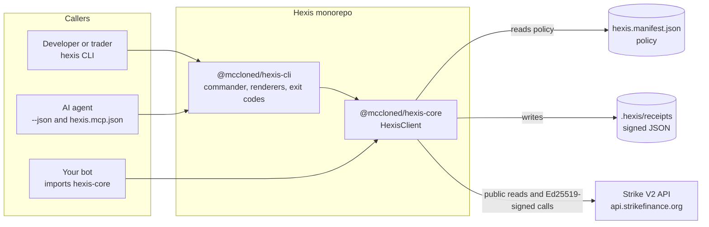
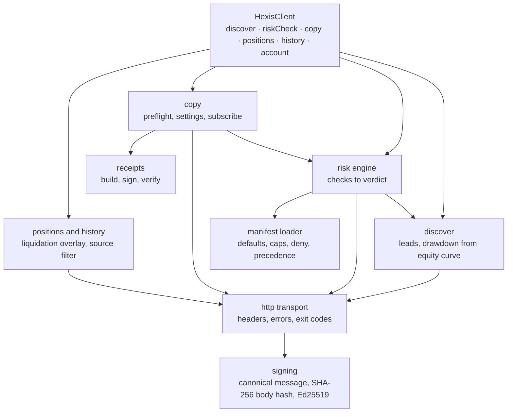
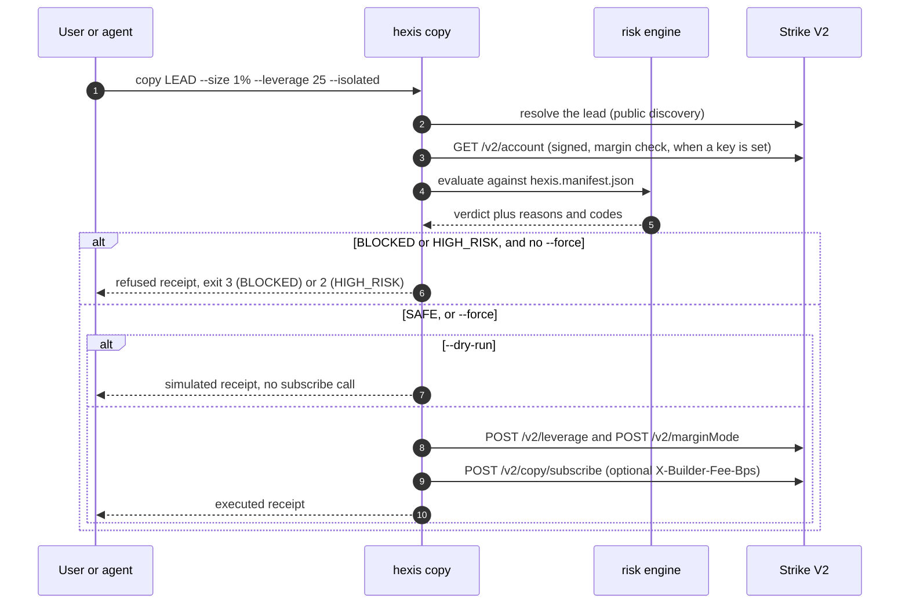

# Hexis - a risk-aware CLI and TypeScript toolkit for Strike Finance perpetuals

Built for the Strike Finance 48-hour hackathon (Oct 21-23, 2026). Strike's API is powerful, but every builder ends up rebuilding the same plumbing: byte-exact Ed25519 request signing, copy-lead discovery, and some way to avoid copying a trader straight into a liquidation. Hexis packages that plumbing into a CLI (`hexis`) and a TypeScript client, adds a policy-driven risk preflight on top, and leaves a signed receipt for every copy decision.

[](https://www.npmjs.com/package/@mccloned/hexis-cli) 

- **Demo video:** `<paste YouTube link>`
- **npm:** [`@mccloned/hexis-cli`](https://www.npmjs.com/package/@mccloned/hexis-cli) and [`@mccloned/hexis-core`](https://www.npmjs.com/package/@mccloned/hexis-core)
- **Repo:** https://github.com/DiverseXL/hexis
- **A real signed receipt:** [`docs/sample-receipt.json`](docs/sample-receipt.json)

```bash
npx --package=@mccloned/hexis-cli hexis discover --platform hyperliquid --top 5
npx --package=@mccloned/hexis-cli hexis risk-check <lead-address> --leverage 8 --isolated
```

---

## Contents

1. [What it does](#1-what-it-does)
2. [Quick start](#2-quick-start)
3. [Command reference](#3-command-reference)
4. [The risk engine and the policy file](#4-the-risk-engine-and-the-policy-file)
5. [Signed receipts](#5-signed-receipts)
6. [Architecture](#6-architecture)
7. [Strike integration](#7-strike-integration)
8. [Agent surface](#8-agent-surface)
9. [Security model](#9-security-model)
10. [Live proof](#10-live-proof)
11. [Development and testing](#11-development-and-testing)
12. [Design decisions](#12-design-decisions)
13. [Known limitations](#13-known-limitations)
14. [Roadmap](#14-roadmap)

---

## 1. What it does

| Pain point on Strike | What Hexis does |
|---|---|
| Every authenticated call needs a byte-exact Ed25519 signature over `{METHOD}:{PATH}:{TIMESTAMP}:{NONCE}:{BODY_HASH}`; a mistake is a bare 401 | `@mccloned/hexis-core` signs every request and ships RFC 8032 test vectors |
| Copy discovery is a separate flow from risk | `hexis discover` ranks Hyperliquid and Strike leads (PnL, equity, 30-day max drawdown) with no wallet needed |
| Nothing stops you copying a trader into a liquidation | `hexis risk-check` evaluates a proposed copy against a policy file and returns SAFE, HIGH_RISK or BLOCKED with reasons and machine-readable codes |
| Copy execution needs leverage and margin mode set first | `hexis copy` runs the preflight, refuses on BLOCKED unless `--force`, then sets leverage and margin mode before subscribing |
| No audit trail | Every copy attempt, including refusals, writes an Ed25519-signed JSON receipt |
| Agents hallucinate signing and leverage | Every command has `--json`, and a tool manifest (`hexis.mcp.json`) describes the surface |

Hexis is a developer toolkit, not a trading terminal or a bot. It focuses on Strike's copy-trading surface and deliberately does not abstract other exchanges.

---

## 2. Quick start

Requirements: Node.js 20 or newer. A Strike API wallet is needed only for signed commands (`positions`, `history`, `copy`, and the margin check inside `risk-check`).

### Run without installing

```bash
npx --package=@mccloned/hexis-cli hexis discover --platform hyperliquid --top 5
```

### Install

```bash
npm install -g @mccloned/hexis-cli      # gives you the `hexis` command
pnpm add @mccloned/hexis-core           # the TypeScript client
```

### From source

```bash
git clone https://github.com/DiverseXL/hexis.git
cd hexis
pnpm install
pnpm -r build
node packages/cli/dist/index.js --help
```

### Create and register an API wallet

```bash
hexis init --out ./hexis-key.json       # writes a raw hex Ed25519 keypair; prints the public key
```

1. Open https://app.strikefinance.org/api-keys and register the **public key**.
2. Give Hexis the private key through the environment (never commit it):

```bash
export HEXIS_PRIVATE_KEY=<private-hex>          # bash / zsh
```

```powershell
$env:HEXIS_PRIVATE_KEY = "<private-hex>"        # PowerShell
```

3. Check that signing works against the live API:

```bash
hexis positions
```

A response with an empty list is a pass: the signature was accepted.

### The 40-second demo

```bash
hexis discover --platform hyperliquid --top 5
hexis risk-check <lead> --leverage 8 --isolated      # SAFE
hexis risk-check <lead> --leverage 25 --isolated     # BLOCKED
# edit hexis.manifest.json: caps.maxLeverage.default 10 -> 5
hexis risk-check <lead> --leverage 8 --isolated      # now BLOCKED
```

---

## 3. Command reference

Every command accepts `--json` for machine-readable output.

| Command | Auth | What it does |
|---|---|---|
| `hexis init [--out <file>] [--json]` | none | Generates a raw hex Ed25519 keypair. Writes a file only if `--out` is given |
| `hexis discover` | none | Lists copy leads |
| `hexis risk-check <lead>` | optional | Preflights a proposed copy and prints a verdict |
| `hexis copy <lead>` | signed | Runs the preflight, then subscribes to a lead (or refuses) |
| `hexis positions` | signed | Shows open positions with liquidation prices |
| `hexis history` | signed | Shows fills, filterable by source |

### discover

```bash
hexis discover --platform hyperliquid --rank pnl_30d --top 5
hexis discover --platform strike --top 3 --json
```

| Flag | Meaning |
|---|---|
| `--platform hyperliquid\|strike` | Which leaderboard to read |
| `--rank <key>` | Ranking key (default `pnl_30d`) |
| `--top <n>`, `--limit <n>` | How many leads to return |
| `--json` | JSON output |

Hyperliquid leads are `0x` addresses. Strike leads are UUIDs.

### risk-check

```bash
hexis risk-check 0x5b5d51203a0f9079f8aeb098a6523a13f298c060 --leverage 8 --isolated
hexis risk-check <lead> --leverage 25 --isolated --json
```

| Flag | Meaning |
|---|---|
| `--leverage <n>` | Proposed leverage |
| `--size <pct>` | Proposed copy size as a percentage (default from the manifest) |
| `--isolated` | Isolated margin (default from the manifest) |
| `--json` | JSON verdict |

The market defaults to the lead's primary market. `risk-check` has no `--platform` flag: pass the address or UUID as the argument.

### copy

```bash
hexis copy <lead> --size 1% --leverage 3 --isolated --dry-run
hexis copy <lead> --size 5% --leverage 8 --isolated --builder-fee-bps 10
hexis copy <lead> --size 5% --leverage 8 --isolated --force
```

| Flag | Meaning |
|---|---|
| `--dry-run` | Runs the preflight and writes a `simulated` receipt without calling `/v2/copy/subscribe` |
| `--force` | Proceeds despite a BLOCKED or HIGH_RISK verdict |
| `--builder-fee-bps <n>` | Sends the `X-Builder-Fee-Bps` header (Strike's maximum is 100) |
| `--copy-existing` | Also copies the lead's existing positions |
| `--json` | JSON output |

### positions and history

```bash
hexis positions --watch --interval 5
hexis history --source copy --symbol BTC-USD --limit 20
```

`history --source copy` returns only fills created by copy trading. Without `--source`, fills of every source are returned and labelled `manual` (see [limitations](#13-known-limitations)).

### Exit codes

| Code | Meaning |
|---|---|
| 0 | SAFE, or the action succeeded |
| 1 | ERROR (network, authentication, signing) |
| 2 | HIGH_RISK without `--force` |
| 3 | BLOCKED |

---

## 4. The risk engine and the policy file

`risk-check` and `copy` evaluate a proposed copy against `hexis.manifest.json`. Each check returns pass or fail with a message; the worst result becomes the verdict.

| Check | Fails when | Verdict |
|---|---|---|
| `lead-found` | The lead cannot be resolved | ERROR |
| `leverage-cap` | Requested leverage exceeds the cap for the market | BLOCKED (`LEVERAGE_EXCEEDS_POLICY`) |
| `liquidation-distance` | Estimated liquidation distance is below the minimum | BLOCKED (`LIQUIDATION_TOO_CLOSE`) |
| `lead-drawdown` | The lead's 30-day max drawdown exceeds the cap | BLOCKED (`LEAD_DRAWDOWN_EXCEEDS_POLICY`) |
| `margin` | Copy notional is below the market minimum (needs an API wallet) | BLOCKED (`INSUFFICIENT_MARGIN`) |
| `margin-mode` | Margin mode is not allowed | reported |
| deny list | The lead or market is in the manifest deny list | BLOCKED |
| equity curve | The lead has no equity curve data | HIGH_RISK, never SAFE |

When everything passes, the code is `OK`. Without an API wallet the margin check is skipped, and the output says so: `Account balance unavailable; margin check skipped`.

Liquidation distance is an approximation: `max(0, 100 / leverage - 1.1)` percent. It does not use per-market maintenance margin or the entry price. For example, 8x gives about 11.4% and 25x gives about 2.9%.

### hexis.manifest.json

```json
{
  "version": 1,
  "defaults": { "isolated": true, "leverage": 8, "sizePct": 5, "requireRiskCheck": true },
  "caps": {
    "maxLeverage": { "default": 10, "BTC-USD": 15, "ETH-USD": 15 },
    "minLiquidationDistancePct": 5,
    "maxLeadDrawdown30dPct": 25
  },
  "deny": { "leads": [], "markets": [] }
}
```

File precedence: `~/.hexis/manifest.json`, then `./hexis.manifest.json`, then the file named by `HEXIS_MANIFEST`, then an explicit `--manifest` path. Environment variables can override individual scalar values, and an explicit `--manifest` wins over them. Symbol caps merge with the defaults. Invalid JSON or invalid values fail loudly.

### Example verdicts (real output)

```text
$ hexis risk-check 0x5b5d...c060 --leverage 8 --isolated

  Lead:      0x5b5d...c060  (hyperliquid)
  30d PnL:   +52.7%     Equity: $264,750,297     Max DD 30d: 22.9%
  Copy size: 5%  Leverage: 8x  Isolated  Market: PUMP-USD

  VERDICT:   SAFE
  Reason:    Leverage 8x <= cap 10x
             Estimated liquidation distance 11.4% >= min 5%
             Lead 30d max drawdown 22.9% <= cap 25%
             Account balance unavailable; margin check skipped
  Code:      OK
```

```text
$ hexis risk-check 0xecb6...2b00 --leverage 8 --isolated

  VERDICT:   BLOCKED
  Reason:    Leverage 8x <= cap 15x
             Estimated liquidation distance 11.4% >= min 5%
             ! Lead 30d max drawdown 41.8% > cap 25%
  Suggested: size 2%
  Code:      LEAD_DRAWDOWN_EXCEEDS_POLICY
```

---

## 5. Signed receipts

Every `copy` attempt writes a JSON receipt to `.hexis/receipts/` (override with `HEXIS_RECEIPT_DIR`). Refusals are receipted too. `outcome` is one of `refused`, `simulated` or `executed`.

A receipt records the mandate in plain English, the endpoint, the request nonce and body hash, the full verdict with every check, the API wallet public key, a hash of the receipt, and an Ed25519 signature. It never contains key material. See [`docs/sample-receipt.json`](docs/sample-receipt.json), a live refusal of a 25x copy.

Verify a receipt:

```ts
import { readFileSync } from 'node:fs';
import { verifyReceipt } from '@mccloned/hexis-core';

const receipt = JSON.parse(readFileSync('docs/sample-receipt.json', 'utf8'));
console.log(verifyReceipt(receipt)); // true; change any field and it returns false
```

---

## 6. Architecture

Hexis follows one rule: the logic lives in `@mccloned/hexis-core`, and the CLI is a thin wrapper that parses flags, renders output and sets exit codes.

### System overview



### Inside the core package



### Life of a copy



### Request signing

Every authenticated request carries four headers:

| Header | Value |
|---|---|
| `X-API-Wallet-Public-Key` | 64-character hex Ed25519 public key |
| `X-API-Wallet-Signature` | Ed25519 signature (128 hex characters) over the canonical message |
| `X-API-Wallet-Timestamp` | Unix time in seconds |
| `X-API-Wallet-Nonce` | Fresh UUID v4 for every request |

The canonical message is `{METHOD}:{PATH}:{TIMESTAMP}:{NONCE}:{BODY_HASH}`. `PATH` includes the query string and excludes the host. `BODY_HASH` is the SHA-256 hex of the exact serialized body (the empty-string hash when there is no body). The body is serialized once, and the same string is hashed and sent. Keys must be raw hex; SSH-format keys are rejected. Private keys may be 64 or 128 hex characters.

### Repository layout

```text
packages/
  core/                       @mccloned/hexis-core
    src/
      signing.ts              canonical message, body hash, Ed25519 signing
      http.ts                 transport and error mapping
      client.ts               HexisClient
      discover.ts             lead discovery and drawdown calculation
      risk.ts                 risk engine, verdicts
      copy.ts                 preflight, leverage and margin setup, subscribe
      positions.ts            positions with liquidation overlay
      history.ts              fill history with source filter
      receipt.ts              build, sign, verify, write receipts
      types.ts                public types
    test/                     signing, manifest, risk, receipt, copy, mcp, live
  cli/                        @mccloned/hexis-cli (binary: hexis)
    src/
      index.ts                command registration
      format.ts               verdict and table renderers
      context.ts              client and manifest wiring
      commands/               init, discover, risk-check, copy, positions, history
    test/format.test.ts
examples/                     basic-copy.ts, risk-policy.ts, agent-skill.ts
docs/                         SECURITY.md, AGENT.md, sample-receipt.json
hexis.manifest.json           default policy
hexis.mcp.json                tool manifest for agents
```

---

## 7. Strike integration

Every endpoint below was checked against Strike's API documentation. The Status column shows what was also exercised against the live API.

| Endpoint | Method | Auth | Used for | Status |
|---|---|---|---|---|
| `/v2/copy/discover` | GET | public | Ranked leads | live |
| `/v2/copy/discover/{id}` | GET | public | Single lead, nickname search fallback on 404 | docs-checked |
| `/v2/account` | GET | signed | Account and margin check | live |
| `/v2/positions` | GET | signed | Open positions | live |
| `/v2/copy/positions` | GET | signed | Copy positions (uses the documented `own` flag) | docs-checked |
| `/v2/history/fill` | GET | signed | Fills, filter `source=copy` | live |
| `/v2/leverage` | POST | signed | Set symbol leverage before a copy | docs-checked |
| `/v2/marginMode` | POST | signed | Set margin mode before a copy | docs-checked |
| `/v2/copy/subscribe` | POST | signed | Start a copy, optional builder fee header | docs-checked, unit-tested |
| `/price/v2/ticker/price` | GET | public | Mark price | docs-checked |

Strike features used: Ed25519 API wallets (`ApiWalletAuth`), Hyperliquid and Strike copy discovery, source-filtered fill history, builder fee header, isolated and cross margin settings.

---

## 8. Agent surface

- Every command supports `--json`, and errors are structured with a code and an exit status.
- `hexis.mcp.json` and the exported `MCP_MANIFEST` describe the tools an agent can call (discover, risk-check, copy and the read commands) with input schemas. A test keeps the exported manifest and the file in sync.
- The intended flow for an agent is: call `risk-check`, read `status` and `code`, then decide whether to call `copy`. The agent never constructs a signature or sets leverage by hand.

This is a tool manifest and an example (`examples/agent-skill.ts`), not a running MCP server. See [`docs/AGENT.md`](docs/AGENT.md).

---

## 9. Security model

- Strike API wallets can trade but cannot withdraw funds (Strike API docs, Getting Started). A leaked Hexis key is limited to trading actions.
- Private keys stay on your machine. Only signatures are sent to Strike.
- `hexis init` writes a key file only when you pass `--out`. `HEXIS_PRIVATE_KEY` is read from the environment and never logged.
- Receipts contain the public key only. `.hexis/`, `.env` and `.env.*` (except `.env.example`) are git-ignored.
- Requests are signed with Unix seconds, so keep your system clock synced. A drifted clock produces `401 signature expired or invalid timestamp`.

See [`docs/SECURITY.md`](docs/SECURITY.md).

---

## 10. Live proof

Run against Strike mainnet with a registered API wallet on 2026-10-23:

| Check | Result |
|---|---|
| `hexis discover` (Hyperliquid and Strike) | Returned live ranked leads |
| `hexis risk-check` on live leads | SAFE at 8x for a 22.9%-drawdown lead; BLOCKED at 25x; BLOCKED for a 41.8%-drawdown lead |
| Manifest flip | Lowering `maxLeverage.default` from 10 to 5 changed the same 8x check from SAFE to BLOCKED; restoring the file returned it to SAFE |
| `hexis positions`, `hexis history --source copy` | Signed calls accepted by the live API (an account with no open positions returned empty lists) |
| `hexis copy ... --leverage 25` | Refused with exit code 3 and a signed receipt ([`docs/sample-receipt.json`](docs/sample-receipt.json)) |
| `verifyReceipt()` on that receipt | true; false after tampering with any field |

Reproduce the public part yourself, with no wallet:

```bash
npx --package=@mccloned/hexis-cli hexis discover --platform hyperliquid --top 3
```

---

## 11. Development and testing

```bash
pnpm install
pnpm -r build
pnpm -r typecheck
pnpm -r test
```

38 tests: 35 in core and 3 in the CLI. Coverage includes RFC 8032 signing vectors, the canonical message and body hash, key validation, manifest precedence, every risk check, the manifest flip, copy refusal, forced copy and dry-run behaviour (with a mocked transport), receipt signing and tamper detection, and MCP manifest consistency.

One test calls the live API (`GET /v2/account`). It is skipped unless `HEXIS_PRIVATE_KEY` is set to a registered API wallet:

```bash
HEXIS_PRIVATE_KEY=<private-hex> pnpm -r test
```

Copy `.env.example` to `.env` for local configuration:

| Variable | Meaning |
|---|---|
| `HEXIS_PRIVATE_KEY` | API wallet private key (raw hex) |
| `HEXIS_BASE_URL` | API base URL (default `https://api.strikefinance.org`) |
| `HEXIS_RECEIPT_DIR` | Receipt directory (default `.hexis/receipts`) |
| `HEXIS_MANIFEST` | Path to a policy file |

---

## 12. Design decisions

- **Core plus thin CLI.** Everything testable lives in `hexis-core`. The CLI cannot disagree with the library because it only renders what the library returns.
- **Verdicts, not booleans.** A decision carries a status, a machine-readable code and human-readable reasons, so a person and an agent can both act on it.
- **Policy as a file.** Changing one number in the manifest changes the verdict. That keeps the risk engine inspectable and makes it easy to adapt to your own tolerance.
- **Preflight works without a wallet.** Lead and drawdown checks use public data. A wallet adds the margin check, and the output says when it was skipped.
- **Refusals are receipted.** A blocked copy is a decision worth recording, so it gets the same signed receipt as an executed one.
- **Strike only.** The toolkit goes deep on Strike's copy-trading surface instead of wrapping many venues.

---

## 13. Known limitations

- Signed reads (`positions`, `history`) and the copy refusal path are verified live. An executed (non-dry-run) copy has not been tested live, because the demo account has no available margin. It is covered by unit tests with a mocked transport and by checks against the API documentation.
- Position parsing has been verified live only against an account with no open positions.
- Whether Strike accepts `--builder-fee-bps` end to end on a live copy has not been observed.
- Liquidation distance is a leverage-based approximation and ignores per-market maintenance margin and entry price.
- `history` without `--source` labels every fill `manual`, even though the response also contains copy, TWAP and grid fills.
- The HIGH_RISK exit code (2) is covered by unit tests only; no live lead produced a warn-only verdict.
- Strike discovery can include degenerate leads (for example zero equity and absurd ROI). The risk engine blocks them, but the discovery table does not hide them.
- The MCP surface is a manifest and an example, not a running server.

---

## 14. Roadmap

- Verify an executed copy end to end on a funded account and record the receipt.
- Position stream over WebSocket for live liquidation-distance alerts (REST polling is the default today).
- Replace the liquidation approximation with per-market maintenance margin from Strike's market data.
- A real MCP server over the core client.
- Subaccount helpers for strategy isolation.

---

## License

[MIT](LICENSE) 2026 DiverseXL